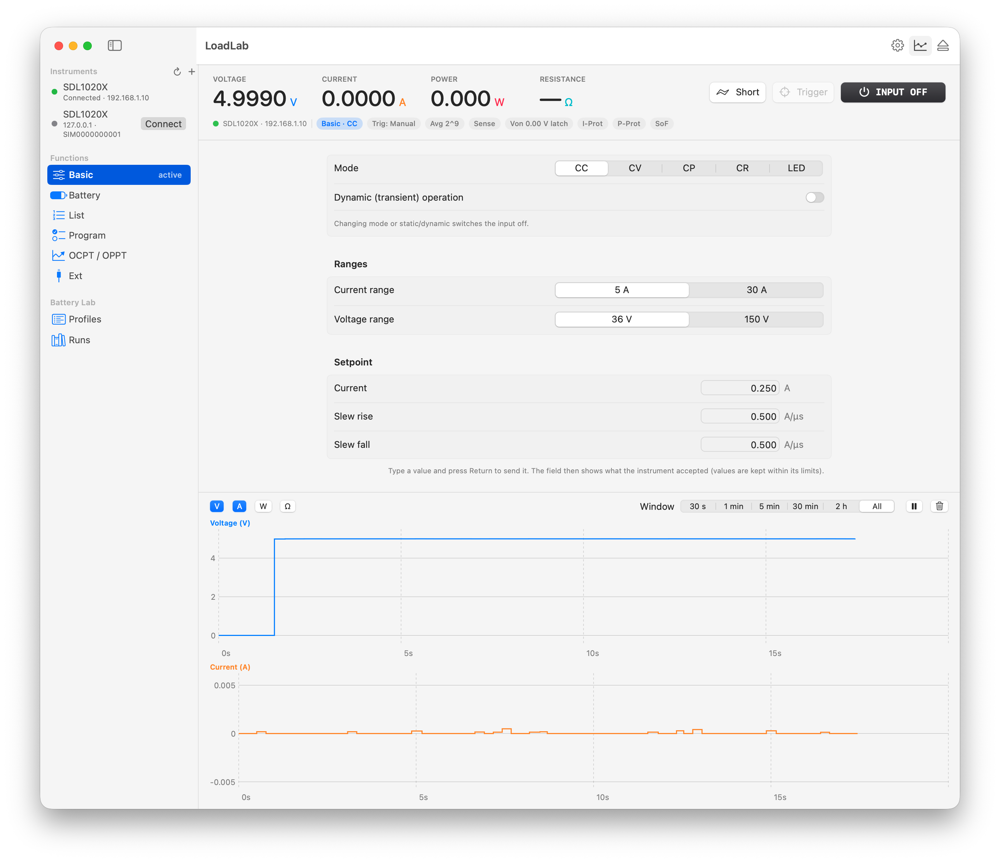
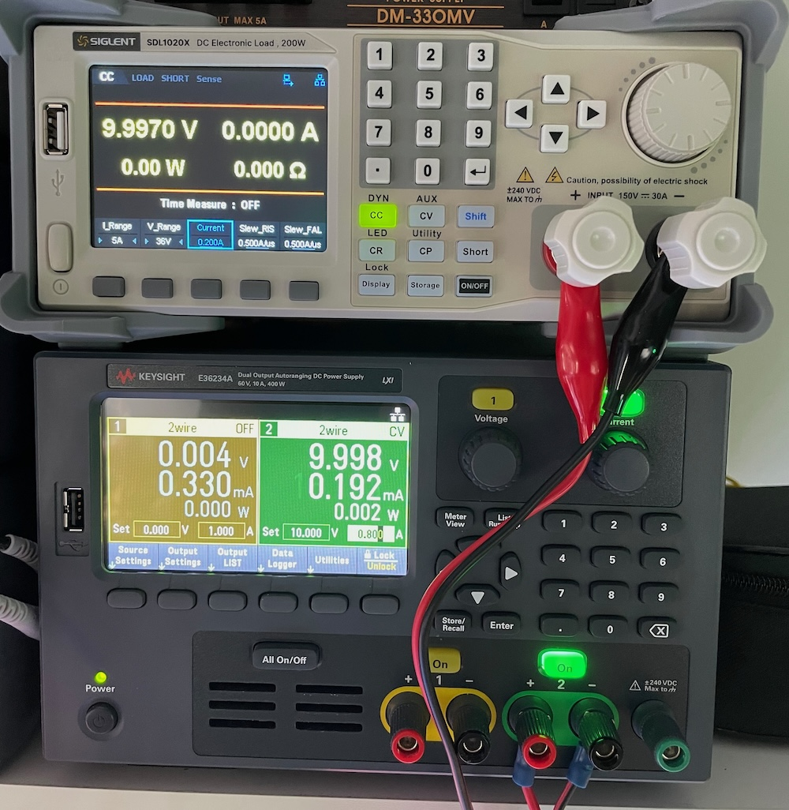

# LoadLab

A native macOS app for the **Siglent SDL1000X** series of programmable DC electronic loads, controlled over the
network (SCPI over raw TCP, port 5025). It covers what Siglent's Windows-only *EasySDL* utility does: the Basic,
Battery, List, Program, OCPT/OPPT and Ext screens. It adds a battery-characterization workbench: recorded
discharges, a run library with overlays and analysis, and app-scripted test profiles with layered safety.



This app was developed and tested against an **SDL1020X** (firmware 1.1.1.23R4). Other SDL1000X models use the same command set
and should work, but haven't been tried.

> **Status:** personal project, feature-complete for its first round and now in real-world use. See
> [Testing status](#testing-status) for what has and hasn't been verified on hardware.

---

## Features

### Instrument control
- **Connection:**
  - Finds instruments by sweeping the local subnet on TCP 5025; the SDL has no mDNS and no UDP discovery. You can
    also add an instrument by IP address.
  - Reconnects automatically with backoff and detects when another program holds the SDL's single connection.
- **Live readout bar:** V / A / W / Ω, input on/off, short, trigger, and status chips (mode, trigger source,
  averaging, sense, Von, protections).
- **Live chart:** V, I, P and R against time, with selectable time windows, pause and clear.
- **Basic:** CC / CV / CP / CR / LED, ranges, setpoints, slew rates, and dynamic (transient) operation in continuous,
  pulse and toggle modes.
- **List:** an editable step table (level, width, slew), repeat count, CSV import/export, and runs with the executing
  step highlighted.
- **Program:** an editable step table with a per-step inspector, and pass/fail judgement of each step's measured
  value. Also stop-on-fail and CSV import/export.
- **OCPT / OPPT:** ramp settings, trip voltage and pass window. The instrument doesn't report the trip point, so
  LoadLab samples quickly during the ramp and finds it; results show with traces.
- **Ext:** external analog-control mode and ranges, plus a live reading of the rear-panel control voltage.
- **Instrument settings:** sense, Von and latch, current/power protection, averaging, trigger source, monitor
  outputs, and more.
- **Edits are read back from the instrument:** every change is checked against its limits, written with
  confirmation, and read back. The fields show what the SDL accepted.
- **SCPI console** (⌥⌘K) with a command log.

### Battery characterisation
- **Battery tests** use the instrument's Battery function (CC/CP/CR with voltage, capacity and time stop conditions):
  - LoadLab integrates capacity and energy itself, below 1 mAh resolution. The instrument's 1 mAh counter is kept as a
    cross-check.
  - Live charts: V vs capacity, V and I vs time, and P vs time.
  - Recording survives an app restart. If the instrument is still discharging, LoadLab resumes the run; otherwise it
    closes it using the instrument's counters.
- **Run library** (works offline):
  - Sortable and searchable.
  - Per-run analysis: capacity and energy, average and mid-point voltage, state of health against nominal capacity,
    DC resistance from current steps, and dQ/dV.
  - Overlay several runs, with the x-axis as mAh, % of nominal, Wh or time, plus a comparison table.
  - Export a chart as PNG or a one-page PDF report.
- **Profiles:** app-scripted discharge sequences built from steps:
  - Step types: Hold (CC/CP/CR until a time, capacity or voltage), Rest, Pulse train, two-current DC resistance,
    Repeat, and Mark.
  - Templates:
    - Constant-current capacity
    - Multi-rate (rate capability)
    - Pulse discharge
    - Internal resistance vs state of charge (HPPC-style)
    - Constant-power runtime
- **Safety layers for profiles** (the app is in the control loop):
  1. A watchdog checks every reading for the cut-off voltage, a current limit, and optional capacity and time limits.
  2. Before the input turns on, the instrument's Von is set just below the cut-off with latch off, and read back. This
     stops the load even if the Mac sleeps, crashes or loses the network. Verified on hardware with LoadLab fully
     disconnected.
  3. The Mac is kept awake while any run is active.
  4. If the connection drops, the input is switched off on reconnect. A profile is never resumed after a restart.
  5. The user's Basic, Von and latch settings are restored afterwards.
- **Quitting during a run** asks first. A Battery test can be left running on the instrument, which enforces its own
  stop conditions, and is picked up again on relaunch.

Run data lives in `~/Documents/LoadLab/Runs/<date>_<title>/`: `samples.csv` (streamed, crash-safe) plus `run.json`
(settings, events, summary). Profiles are JSON files in `~/Documents/LoadLab/Profiles/`.

---

## Requirements

- macOS 15 or later.
- Xcode with Swift 6 (developed with Swift 6.4). There are no third-party dependencies.
- An SDL1000X on the same network, with LAN enabled.
- The app needs **Local Network** permission: macOS asks on first connect. If it is blocked, enable it in
  *System Settings → Privacy & Security → Local Network*.

## Building

LoadLab is a Swift Package; no Xcode project is needed.

```sh
# Build and bundle LoadLab.app (release, ad-hoc signed) into ./build/
scripts/bundle.sh

# …or also install it to /Applications
scripts/bundle.sh --install

open build/LoadLab.app
```

For development you can also run the app straight from SwiftPM with `swift run LoadLab`. Use the bundled app for
real use: Local Network permission is tied to the app bundle.

> Ad-hoc signing means macOS may ask for Local Network permission again after each rebuild. A stable signing identity
> (for example a self-signed certificate) avoids that.

The app icon is drawn in code. To regenerate it, run `swift scripts/make-icon.swift Resources/LoadLab.icns`.

### Command-line tool: `sdlctl`

```sh
swift run sdlctl discover                       # find instruments on the local subnets
swift run sdlctl idn 192.168.1.10               # *IDN?
swift run sdlctl send 192.168.1.10 ":INP?"      # raw commands/queries
swift run sdlctl monitor 192.168.1.10 4 60      # stream V/I/P/R as CSV
swift run sdlctl snapshot 192.168.1.10 s.json   # save all user settings
swift run sdlctl diff 192.168.1.10 s.json       # compare against a snapshot
swift run sdlctl restore 192.168.1.10 s.json    # restore (input forced off)
swift run sdlctl sim 5025 --demo                # run the simulator (see below)
```

`<host>` may be `host:port`; `$SDL_HOST` sets a default.

### Simulator

`SDLSimulator` is a fake SDL1000X TCP server. It reproduces the real instrument's measured quirks:
- a single client at a time
- silence on unknown commands
- processing delays
- error replies ending in a blank line
- clamping
- List/Program/OCPT run behaviour

It also models a battery and a current-limited source. Point the app at it with
`build/LoadLab.app/Contents/MacOS/LoadLab --connect 127.0.0.1:5025` to develop without hardware.

## Project layout

| Module | Purpose |
|---|---|
| `SCPIKit` | Raw-socket SCPI transport: one command in flight, every write confirmed with `*OPC?`, timeouts and resync, discovery |
| `SDLKit` | Typed SDL1000X command set, measured limits, settings snapshot/restore |
| `SDLSimulator` | Fake instrument for tests and development |
| `LoadLabCore` | UI-free app logic: session and polling, recorder, run store, analysis, profiles engine, List/Program/OCPT runs |
| `LoadLab` | SwiftUI app |
| `sdlctl` | Command-line tool |

Further reading:
- [`docs/hardware-notes.md`](docs/hardware-notes.md) records everything measured on the real instrument: command
  quirks, limits, run semantics and safety behaviour. Read it before changing the transport or command layer.
- [`plan.md`](plan.md) is the original implementation plan, with a progress log for each phase.

## Testing

```sh
swift test                                   # simulator + unit tests (~80 tests, no hardware needed)
```

The hardware tests are opt-in and need real instruments. They must run serially, because the SDL accepts only one
connection at a time:

```sh
# T1: settings set/read-back on the SDL; the input stays OFF
SDL_HW_HOST=192.168.1.10 swift test --no-parallel --filter HardwareT1

# T2: real current, with a Keysight E36234A (output 2 only) wired to the SDL input as the "device under test"
SDL_HW_HOST=192.168.1.10 PSU_HW_HOST=192.168.1.85 swift test --no-parallel --filter HardwareT2
```

How the hardware tests behave:
- They snapshot the SDL's settings first and restore them afterwards.
- T2 caps the supply's current limit below 1 A in code.
- After a hardware run, also compare the SDL against a snapshot you took beforehand
  (`sdlctl diff <host> <file>`). A failed test can leave a setting changed, and later tests would then treat that as
  their baseline.

`HardwareProbe` tests (gated by `SDL_PROBE=1`) are exploratory. They print time series rather than asserting
anything.

---

## Testing status

### Verified on hardware (SDL1020X + Keysight E36234A as the source)



- Every setting on every screen: set, read back, and snapshot/restore.
- Sinking in CC, CR, CP and CV; dynamic mode; short; emergency off.
- Von with latch off works as a hardware under-voltage stop, **including with LoadLab disconnected**.
- Battery-function runs ending at the voltage cut-off, with the supply ramping down to emulate a discharging cell.
- A full profile run: holds, rest, DC resistance, pulses, and the cut-off. A connection dropped mid-profile switches
  the input off on reconnect.
- List and Program runs, including Program pass/fail and CV steps measuring current.
- OCPT and OPPT, both tripping against the supply's current limit and not tripping.

### Needs more testing
- **Real batteries:** no capacity test on an actual cell has been done yet. Things to check:
  - LoadLab's integrated mAh against the instrument's counter (expect agreement within about 1%).
  - Behaviour at the knee near the cut-off.
  - Long runs lasting hours.
  - Resume after the Mac sleeps or LoadLab quits mid-run.
  - The internal-resistance-vs-state-of-charge template against the instrument's own DC resistance result.

  Wire remote sense at the cell for accurate voltage under load.
- **Ext mode under load:** only the settings and the control-voltage reading were tested. There was no 0–10 V control
  source on the test bench.
- **Other models and firmware:** only an SDL1020X on firmware 1.1.1.23R4 was tested. The 30 A / 150 V ranges were
  exercised only at low current (the bench limit was under 1 A).
- **OCPT/OPPT against real device protection:** these were tested against a bench supply's current limit, which once
  oscillated instead of collapsing; LoadLab stops such runs after the ramp's longest possible time. A real device's
  over-current or over-power protection, which normally cuts its output completely, hasn't been tried.
- **The instrument's own current/power protection during profiles:** not used. The app's current watchdog is the
  limit, because how protection trips and clears over SCPI hasn't been characterised.
- **UI paths checked only through automation hooks:** the PNG/PDF and CSV save/open dialogs, and the Run
  confirmations. Long-run behaviour of the live chart and library with very large runs (days, millions of samples) is
  also untested.
- **Multiple instruments:** the app drives one SDL at a time.

## Known limitations
- The SDL accepts **one network client at a time**. Close EasySDL or any other SCPI tool before connecting.
- Discovery is a TCP sweep of the local subnets; instruments on other subnets need their IP entered.
- List, Program and OCPT/OPPT runs are shown live but not saved to the run library. Their step tables export as CSV.
- Profile pulses are timed by the app, so the minimum is 1 s per pulse part. For faster pulses use the instrument's
  dynamic mode on the Basic screen.

## Safety

LoadLab can switch a load on and off unattended. It layers app-side checks with an instrument-side backstop (Von,
latch off) and turns the input off when it quits. Even so:
- Set conservative stop conditions.
- Use cells and wiring rated for the current.
- Never leave a lithium cell discharging unattended without the instrument's own stop conditions armed.

The software is provided as is, with no warranty.

(c) 2026 Doug Gaff
